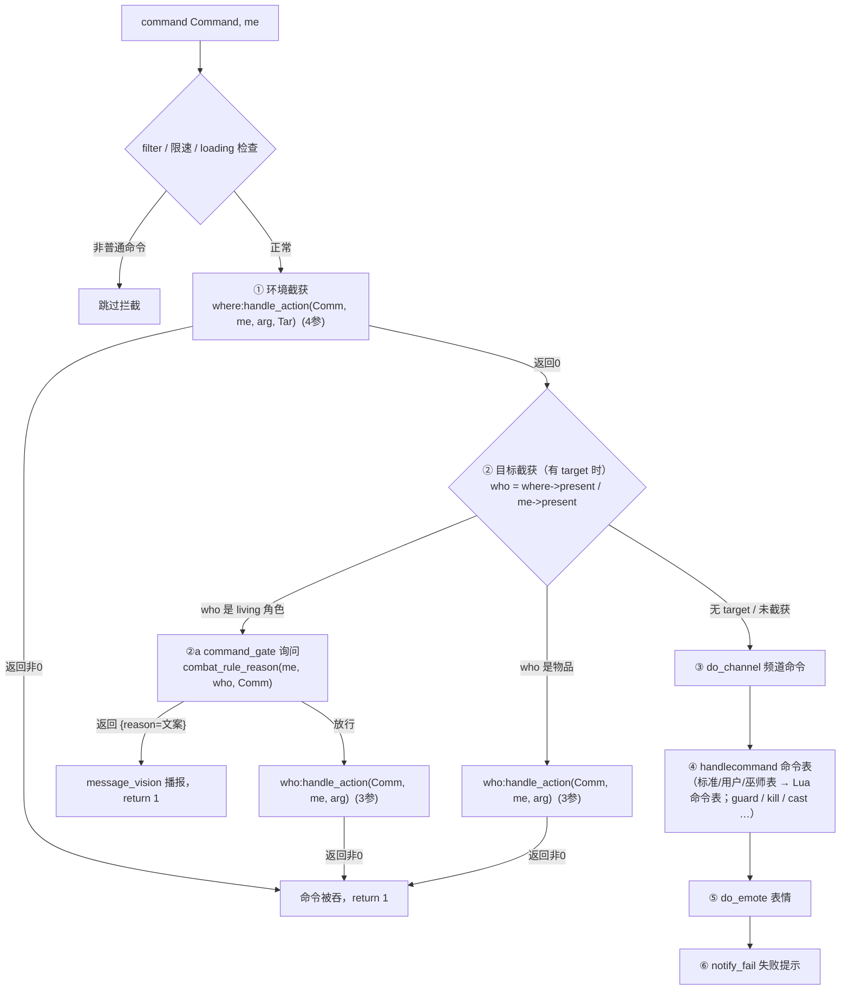

# `handle_action` 使用说明

> 面向 C++/Lua 双层的命令拦截钩子。本文汇总其**设计理念**、**接口定义**、**调用顺序**、**Lua 脚本签名**、**回退语义**、**返回值约定**与**常见陷阱**，并在每处标注源码位置，便于核对。

---

## 一、设计理念

`handle_action` 是「**在标准命令真正执行之前，给场景/对象一次截获（拦截）玩家命令的机会**」。

- 它是 MUD 引擎里「命令分发」与「业务逻辑」之间的**拦截型钩子（interceptor hook）**，而非事件通知：截获成功即**短路**后续所有处理。
- 目的是把散落在 `CmdStandard*` 里、与具体房间/NPC/物品绑定的特殊规则**下沉到脚本层**（Lua），让 C++ 只保留通用驱动，符合 `cpp2lua` 的「能 Lua 化的都 Lua 化」原则。
- 拦截权按「**环境优先、目标其次、命令表最后**」的固定顺序发放，越贴近玩家当前位置的角色越先获得截获机会。

一句话：**`handle_action` = 命令链上的责任链（chain of responsibility），返回非 0 即吞掉命令。**

---

## 二、接口定义（C++ 侧）

抽象接口 `IActionHandler`（`src/interfaces/IActionHandler.h`）声明两个重载：

```cpp
// 三参版：无目标 ID（对目标对象/物品使用）
virtual int handle_action(char* comm, CChar* me, char* arg) = 0;

// 四参版：含目标 ID 字符串 tar（对环境/房间使用）
virtual int handle_action(char* comm, CChar* me, char* arg, char* tar) = 0;
```

| 参数 | 含义 |
|---|---|
| `comm` | 命令名（如 `"guard"`、`"kill"`、`"chblk"`） |
| `me`   | 发出命令的角色 |
| `arg`  | 命令参数（`comm` 之后、目标之外的剩余文本） |
| `tar`  | 目标对象 ID 的字符串形式（仅四参版；通常用 `atol(tar)`/`tonumber(tar)` 还原成 object_id） |

**实现者**：`CChar`、`CItem`、`CRoom`（`IActionHandler.h` 顶部注释）。基类默认实现均返回 0（不拦截）：

- `CChar::handle_action(3 参)` → `return 0`（`src/char/CharInterface.cpp:43`）
- `CItem::handle_action(3/4 参)` → `return 0`（`src/item/ItemInterface.cpp:39`、`:41`）
- `CRoom::handle_action(3 参)` → `return 0`（`src/room/RoomInterface.cpp:23`）

### 基类的「有效默认行为」

四参版并非全为空：

- **`CRoom::handle_action(4 参)`**（`src/room/Room.cpp:338`）实现帮派 `back`（返回总部）命令。
- **`CChar::handle_action(4 参)`**（`src/char/CharInterface.cpp:45`）遍历角色背包内的物品，逐个调用其四参 `handle_action`——这是**随身物品截获命令**的机制（例如武器截获 `kill`）。
- 业务级准入规则（如免战保护）不在 C++ 实现：命令分发器在角色目标截获之前询问
  `hooks.combat_rule("command_gate", actor, target, comm)`，具体状态键由脚本自行约定，见下节调用顺序。
- **居民区脚本**（`lua-default/room/resident_base.lua` 的 `handle_action`，对 `type = "resident"` 的房间由引擎自动装配）处理房产命令（`enter`/`applyhouse`/…），末尾回退房间基类 `base_handle_action4`，即 `CRoom::handle_action`（`src/room/Room.cpp:338`）。
- **房屋脚本**（`lua-default/room/house_base.lua` 的 `handle_action`）截获
  `kill`/`fight`/`cast`/`join` 等，阻止非主人滥用房产，末尾同样回退房间基类
  `base_handle_action4`，即 `CRoom::handle_action`（`src/room/Room.cpp:338`）。

---

## 三、调用顺序（命令分发器）

唯一的命令入口是 `CCmdHandle::command`（`src/cmd/CmdHandle.cpp:151`）。其内部顺序如下（截取关键步骤）：



对应源码：

1. **环境（房间）先截获**（`CmdHandle.cpp:224`）：
   ```cpp
   // 环境所附加的动作, 可截获玩家命令。
   if (!filter
       && dynamic_cast<IActionHandler*>(where)->handle_action(Comm, me, arg, Tar))
       return 1;
   ```
   `where = me->environment()`。注意这里调用的是**四参版**，`me` 站在哪个地图房间，就先进哪个房间的 `handle_action`。

2. **目标对象再截获**（`CmdHandle.cpp:239`，准入询问在 `:243`）：仅当命令带 `target` 且能在房间或背包里 `present` 到对象时：
   ```cpp
   who = where->present(target);
   if (!who) who = me->present(target);
   if (who) {
       if (who->is_character()) {
           if (living(who)) {
               // 命令准入：数据集规则否决即吞掉本次命令并向房间播报文案
               std::string gate = combat_rule_reason(
                   "command_gate", me, static_cast<CChar*>(who), Comm);
               if (!gate.empty()) {
                   message_vision(gate.c_str(), me, who);
                   return 1;
               }
               if (dynamic_cast<IActionHandler*>(who)->handle_action(
                       Comm, me, arg))
                   return 1;                   // 角色：三参版
           }
       }
       else if (dynamic_cast<IActionHandler*>(who)->handle_action(Comm, me, arg))
           return 1;                           // 物品：三参版
   }
   ```

   living 角色先过 `hooks.combat_rule("command_gate", me, who, Comm)`：脚本返回
   `{reason=文案}` 即由 C++ `message_vision` 播报并吞掉命令（「脚本写状态 → 拦截命令」
   这类准入规则全部住在这里，C++ 只负责询问，不认识具体状态键）；
   返回 nil 才继续三参 `handle_action`。物品直接走三参版。

3. 环境/目标都返回 0 后，才轮到 `do_channel` → `handlecommand`（依次查标准/用户/巫师命令表，未命中再分发 Lua 命令表；真正的 `guard`/`kill`/`fight` 实现位于标准命令表）→ `do_emote` → `notify_fail`。

> **要点**：房间钩子（四参）永远**先于**目标对象钩子（三参）；两者都**先于**命令表。因此「限制某类玩家在某场景使用某命令」这类规则写在房间的 `handle_action` 里，会在 `CCmdStandard::guard()`（`src/cmd/CmdStandardCombat.cpp:224`）执行**之前**就把命令拦下。

### 其他调用点

- **随身物品链**：`CChar::handle_action(4 参)`（`src/char/CharInterface.cpp:45`）把命令转发给背包内每个物品的四参 `handle_action`。
- **Lua 全局转发函数** `handle_action(obj, comm, me, arg)`（`src/lua/LuaBindGlue.cpp:380`，注册于 `src/lua/LuaBind.cpp:344`）：供脚本把命令**虚调用**转发给另一个对象继续处理。与 `base_handle_action` 的区别：后者是**非虚**调用 C++ 基类实现。
- **排行榜刷新**：`src/db/SqlRank.cpp:58` 用三参 `handle_action("update", NULL, ...)` 把榜单数据推给界面处理者。

---

## 四、Lua 脚本签名

框架把 C++ `handle_action(comm, me, arg[, tar])` 的参数按同序压入 Lua：

| 脚本类型 | 触发条件 | 查找的脚本字段 | Lua 签名 | 源码 |
|---|---|---|---|---|
| **Room** | C++ 四参 `handle_action` | `handle_action` | `function(self, comm, me, arg, tar)` | `src/lua/LuaRoom.inl:293` |
| **NPC（3 参）** | C++ 三参 `handle_action` | `handle_action` | `function(self, comm, me, arg)` | `src/lua/LuaNpc.inl:272` |
| **NPC（4 参）** | C++ 四参 `handle_action` | `handle_action4` | `function(self, comm, me, arg, tar)` | `src/lua/LuaNpc.inl:306` |
| **Item（3 参）** | C++ 三参 `handle_action` | `handle_action` | `function(self, comm, me, arg)` | `src/lua/LuaItem.inl:305` |
| **Item（4 参）** | C++ 四参 `handle_action` | `handle_action4` | `function(self, comm, me, arg, tar)` | `src/lua/LuaItem.inl:338` |

NPC/Item 的四参版挂在 `handle_action4` 字段，Room 则仍叫 `handle_action`（Room 只有四参这一种入口）。

### 编码（三条分发路径统一 GBK）

脚本源码以 UTF-8 存盘，**加载期统一转 GBK**（`load_file_as_gbk`，`src/lua/LuaEngine.cpp`），
因此 **Lua 字符串空间是 GBK**：脚本字面量、`comm/arg/tar/dir` 入参、`querystr` 出参同为
GBK，可直接比较。三条分发路径（`src/lua/LuaRoom.inl`、`src/lua/LuaNpc.inl`、
`src/lua/LuaItem.inl`）均**原样压栈、不做转码**。运行期需要转换时用绑定函数
`utf8_to_gbk`（无反向绑定 `gbk_to_utf8`）。

> **历史差异（已消除）**：`CLuaRoomT::handle_action/valid_leave` 曾单方面把入参转成
> UTF-8，与字面量方向相反——靠样本命令均为 ASCII 与脚本侧 `utf8_to_gbk` 回转掩盖。
> 已于 2026-10-24 统一为原样压栈，`house_base.lua`/`resident_base.lua` 的回转补偿
> 一并移除；契约由 `tests/unit/test_dispatch_encoding.cpp` 钉住。

---

## 五、回退语义与 `base_*`

模板钩子统一采用**回退语义**：

- 脚本**定义了** `handle_action` → **完全接管**，框架**不再**自动跑 C++ 基类。
- 脚本**未定义 / 未加载 / `lua_pcall` 失败** → 回退到 C++ 基类 `T::handle_action(...)`。
- 需要在接管后**复用基类副作用**时，脚本显式调用：
  ```lua
  self:base_handle_action(comm, me, arg)        -- 回退 3 参基类
  self:base_handle_action4(comm, me, arg, tar)  -- 回退 4 参基类
  ```
  绑定见 `src/lua/LuaBind.cpp:221-222`（`base_handle_action` / `base_handle_action4`），实现 `src/lua/LuaBindGlue.cpp:298` / `:450`。三参版 `base_handle_action` 仅覆盖 NPC 系；四参版 `base_handle_action4` 覆盖房间系（`CLuaRoom`/`CLuaFBRoom`）与 `CLuaNpc`，物品的基类回退由框架自动完成。

**关键：漏写 `base` 回退 = 丢基类功能。** 典型：房间脚本若以 `return 0` 收尾而不调 `base_handle_action4`，就会**吞掉 `CRoom::handle_action` 的帮派 `back`（返回总部）** 逻辑。正确写法应以回退收尾：

```lua
-- 房间脚本通用收尾：未命中自定义分支时回退基类
return self:base_handle_action4(comm, me, arg, tar)
```

`l_base_handle_action` / `l_base_handle_action4` 用 `dynamic_cast` 到具体类型后**非虚限定调用**，避免 Lua→C++→Lua 的无限递归（`src/lua/LuaBindGlue.cpp:296`、`:446-448` 注释）。

---

## 六、返回值约定

| 返回 | 含义 | 后果 |
|---|---|---|
| **非 0** | 已处理 / 已拦截 | `CmdHandle::command` 立即 `return 1`，命令链终止，标准命令**不再执行** |
| **0** | 未处理 | 继续下一环节（目标截获 → 频道 → 标准命令 → emote → notify_fail） |

- 拒绝某命令并给出提示：`return notify_fail("...")`（`notify_fail` 返回 0，但会登记失败文本；若只想吞掉命令不回显，直接 `return 1`）。
- 拦截后主动播报：`tell_object(me, "...")` 再 `return 1`。
- 需要「拦下命令但仍走基类」：在拦截分支里显式 `return self:base_handle_action4(...)`。

---

## 七、典型用例

> 以下片段均为**示意写法**，只演示引擎提供的拦截模式；具体业务规则、文案与状态键由脚本自行实现。

### 7.1 房间按条件拦截命令

房间钩子（四参）在标准命令执行前命中即短路，可直接回绝；发令者站在哪个房间，`where` 就是哪个房间，故拦截发生在 `CCmdStandard::guard()` 之前——**有效**：

```lua
if comm == "guard" and me:query("grant") < 50 then
    tell_object(me, "此处不允许这么做。")
    return 1
end
return self:base_handle_action4(comm, me, arg, tar)
```

### 7.2 房间自定义命令 +其余命令回退基类

房间脚本可以实现命令表之外的自定义命令；未识别的命令一律回退基类，避免吞掉 `back` 等既有逻辑：

```lua
if comm == "my_cmd" then
    local obj = self:Present(tonumber(tar))
    if not obj then return notify_fail("请选中当前房间目标.") end
    -- 业务效果……
    message_vision("$N……", me, obj)
    return 1
end
return self:base_handle_action4(comm, me, arg, tar)
```

### 7.3 NPC 截获移动命令（`handle_action4`）

NPC 的四参钩子挂在**另一个字段名** `handle_action4` 上（字段名见第四节）；命中条件时拦截，否则回退基类：

```lua
function npc.handle_action4(self, comm, me, arg, target)
    if comm == "go" and me:query("level") < 30 then
        self:say("……")
        return 1
    end
    return self:base_handle_action4(comm, me, arg, target)
end
```

### 7.4 菜单驱动命令（Item/NPC 三参版）

`handle_action` 常与 `AddMenuItem`/`SendMenu` 配合：`do_use` 弹出菜单，玩家点击后引擎把菜单项命令回灌进 `CCmdHandle::command`，从而再次经过 `handle_action` 链。菜单项命令串用 `$0`/`$1` 占位对象 ID（`$0` 指菜单所属对象、`$1` 指目标）。

---

## 八、常见陷阱

1. **`comm` 与 `me` 写反**：脚本里 `me:query(...)` 会把字符串当对象、`comm == "guard"` 永远不成立，回退 `base_handle_action` 时还会抛 `bad argument (string expected, got jianghu_object)` 被框架 `pcall` 吞掉并记入 ERROR 日志，命令拦截**静默失效**。评审/编写时对照第四节表格确认字段名与顺序。

2. **忘调 `base` 回退**：房间脚本以 `return 0` 收尾会丢失 `CRoom::handle_action` 的 `back`（`src/room/Room.cpp:338`）；NPC 以 `return 0` 收尾会丢失 `CChar::handle_action(4 参)` 的背包物品转发。凡接管 `handle_action` 又需要基类副作用的，末尾应 `return self:base_handle_action4(...)`（或 3 参版）。

3. **`self:func()` 崩溃**：`self` 是 C++ userdata，脚本自定义函数**不能**用 `self:xxx()` 调用（`attempt to call a nil value`）。必须提取成 `local function` 再直接调用。

4. **`tonumber(tar)` 判空**：`tar` 可能为空串（无目标命令）。房间脚本入口应先 `if me == nil then return 1 end` 之类防御；对目标用 `self:Present(tonumber(tar))` 后要判 `nil` 再用。

5. **编码**：三条分发路径入参与脚本字面量同为 GBK（见第四节），中文参数可直接比较；如脚本内手搓 UTF-8 文本与入参比较会静默不相等，需先 `utf8_to_gbk` 转回。

6. **`CItem.handle_action(...)` 不存在**：Lua 侧并未注册 `CItem` 这类 C++ 类型全局表，`return CItem.handle_action(self, comm, me, arg)` 会因 `indexing a nil value` 报错并被框架 `pcall` 捕获后回退基类——功能上「碰巧」仍回退成功，但属于**无效写法**。物品钩子未定义或 `pcall` 失败时框架会自动回退基类；需要显式回退时写 `self:base_handle_action(comm, me, arg)`（对物品其效果同样是返回 0：`CItem` 的 3 参基类实现本身即返回 0）。

---

## 九、参考源码索引

| 主题 | 位置 |
|---|---|
| 接口声明 | `src/interfaces/IActionHandler.h` |
| 命令分发顺序 | `src/cmd/CmdHandle.cpp:151`（①:224 ②:239，准入询问 `:243`） |
| 命令准入钩子 | `src/combat/CombatRules.cpp:11`（`hooks.combat_rule`） |
| Room 桥接 | `src/lua/LuaRoom.inl:293` / `src/lua/LuaRoom.h:105` |
| NPC 桥接 | `src/lua/LuaNpc.inl:272`（3 参）/ `:306`（4 参，字段 `handle_action4`） |
| Item 桥接 | `src/lua/LuaItem.inl:305`（3 参）/ `:338`（4 参，字段 `handle_action4`） |
| `base` 回退绑定 | `src/lua/LuaBindGlue.cpp:298` / `:450`；注册 `src/lua/LuaBind.cpp:221-222` |
| 全局转发函数 | `src/lua/LuaBindGlue.cpp:380`；注册 `src/lua/LuaBind.cpp:344` |
| 基类默认行为 | `src/room/Room.cpp:338`（back）、`src/char/CharInterface.cpp:45`（背包转发）、`lua-default/room/resident_base.lua`（房产命令）、`lua-default/room/house_base.lua`（房屋命令截获） |
| 编码转换 | `src/util/Encoding.cpp`（加载期 `utf8_to_gbk`；`gbk_to_utf8` 仅日志用） |
